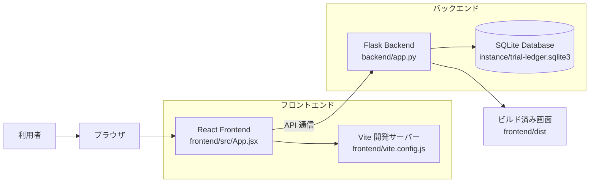
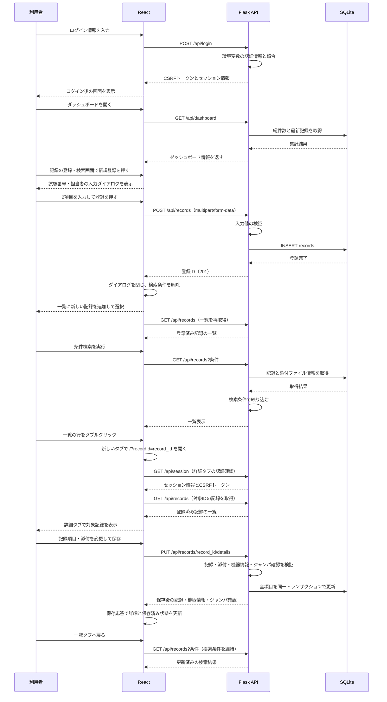
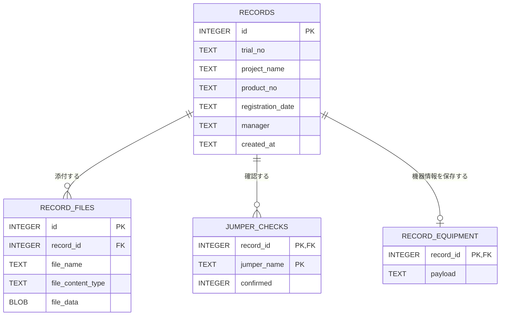

# TestRecordSystem 設計書

## 1. 概要

TestRecordSystem は、試験結果の登録・検索・管理を行う Web アプリケーションです。

- フロントエンド: React
- バックエンド: Flask
- データベース: SQLite
- 目的: 試験記録の一元管理

主な機能は次のとおりです。

- ログイン
- ダッシュボード表示
- 記録の登録・検索画面からの新規登録と検索
- 詳細画面での記録変更、一覧からの削除・コピー
- 詳細画面での添付ファイルの追加・削除・ダウンロード
- 試験結果CSVの温度別表表示と保存前プレビュー
- 記録ごとのジャンパ設定確認と機器情報の保存
- セッションベースの認証

---

## 2. システム構成

> Mermaid が見えない場合は、次のテキスト図を参照してください。

```text
+-------------------+       API/HTML/JS      +--------------------+
| 利用者            | ----------------------> | ブラウザ           |
|  (ユーザー)       |                         | React画面          |
+-------------------+                         +---------+----------+
                                                           |
                                                           | 1. ログイン
                                                           v
                                             +---------------------------+
                                             | Flask API (backend/app.py)|
                                             | - /api/session            |
                                             | - /api/login              |
                                             | - /api/dashboard          |
                                             | - /api/records            |
                                             +------------+--------------+
                                                          |
                                                          | 2. データ保存/検索
                                                          v
                                             +---------------------------+
                                             | SQLite                    |
                                             | instance/trial-ledger.sqlite3 |
                                             +---------------------------+
                                                          ^
                                                          |
                                                          | 3. 結果返却
                                                           
                                             +---------------------------+
                                             | React 画面               |
                                             | ダッシュボード/検索結果  |
                                             +---------------------------+
```



### 2.1 ファイル構成

```text
TestRecordSystem/
├── backend/
│   ├── app.py                     # Flask アプリ、API、SQLite 処理
│   └── trial_results.py           # 試験結果CSVの解析と形式検証
├── requirements.txt               # Python の依存パッケージ
├── README.md                      # セットアップ・起動・運用方法
├── docs/
│   ├── 設計書.md                  # 本設計書
│   ├── 試験結果台帳要件.md         # 要件資料
│   └── images/
│       └── image*.png             # 画面・仕様関連の画像資料
├── tests/
│   └── test_app.py                # Flask API のテスト
├── frontend/
│   ├── package.json               # React/Vite の依存関係とコマンド
│   ├── package-lock.json          # npm 依存関係の固定情報
│   ├── index.html                 # React を表示する HTML の土台
│   ├── style.css                  # React 画面全体のスタイル
│   ├── vite.config.js             # Vite 開発サーバーとビルド設定
│   ├── src/
│   │   ├── main.jsx               # React の起動、CSS の読み込み
│   │   ├── App.jsx                # ログイン・概要・登録検索・詳細画面
│   │   └── TrialResults.jsx       # CSV基本情報・結果表・検索・ページング
│   └── dist/                      # npm run build で生成される配信用ファイル
└── instance/
    └── trial-ledger.sqlite3       # 実行時に作成・使用する SQLite DB
```

`frontend/dist/` と `instance/` は実行・ビルド時に使われるデータです。どちらも Git 管理対象外として設定されています。`.venv/`、`frontend/node_modules/`、`.tools/` も開発環境用で、ソースコードの構成には含めていません。

### 2.2 役割分担

- React Frontend
  - ページの表示を担当
    - ログイン画面、ダッシュボード、記録の登録・検索画面を構成
    - 新規登録はダイアログ、記録の詳細は別ブラウザータブの専用ページで表示する
  - API を呼び出してデータを取得・登録する

- Flask Backend
  - API を提供する
  - 認証・セッション管理を行う
  - SQLite へ接続し、データを保存・検索する
  - 添付ファイルを保存し、ダウンロード可能にする

- SQLite
  - 試験記録の永続化先
    - `records` に記録、`record_files` に添付ファイルを保持する
    - `jumper_checks` にジャンパ確認、`record_equipment` に機器情報を保持する

---

## 3. 実行フロー

```text
[利用者]
   |
   | 1. ログイン入力
   v
[React 画面]
   |
   | POST /api/login
   v
[Flask API]
   | - 環境変数の認証情報と照合
   | - セッション開始
   | - CSRFトークン発行
   v
[SQLite]
   | - データ取得/保存
   v
[Flask API]
   | - 結果を JSON で返却
   v
[React 画面]
   | - ダッシュボード更新
   | - 一覧表示
   v
[利用者]
```



---

## 4. データモデル



### 4.1 `records` テーブルの項目

| 項目名 | 型 | 説明 |
|---|---|---|
| id | INTEGER | レコードの一意な識別子 |
| trial_no | TEXT | 試験番号。必須 |
| project_name | TEXT | 案件名。任意、未入力は空文字で保存 |
| product_no | TEXT | 製番。任意、未入力は空文字で保存 |
| registration_date | TEXT | 登録日（yyyymmdd）。通常の新規登録は当日 |
| manager | TEXT | 担当者。必須 |
| created_at | TEXT | 登録日時 |

添付ファイルは `record_files` テーブルに保存します。1つの記録に複数のファイルを紐づけます。
CSVも元のファイルをBLOBとして保存し、表示用JSONは取得時に解析して返します。解析結果を保存する新しいテーブルは設けません。
旧バージョンのDBにある `records.file_name` / `file_content_type` / `file_data` は、起動時に `record_files` へ移行されます。

| 項目名 | 型 | 説明 |
|---|---|---|
| id | INTEGER | 添付ファイルの一意な識別子 |
| record_id | INTEGER | 親となる `records.id` |
| file_name | TEXT | 添付ファイル名 |
| file_content_type | TEXT | MIME タイプ |
| file_data | BLOB | ファイル本体 |

案件名・製番は `NOT NULL` の既存列に空文字を保存するため、今回の入力項目変更に伴うテーブル再作成は不要です。

### 4.2 `jumper_checks` テーブル

| 項目名 | 型 | 説明 |
|---|---|---|
| record_id | INTEGER | 親となる `records.id`。複合主キーの一部 |
| jumper_name | TEXT | `W1` または `W2`。複合主キーの一部 |
| confirmed | INTEGER | `0`: 未確認、`1`: 確認済み |

ジャンパ設定は全記録共通で `W1: 1-2`、`W2: 1-2` とし、確認結果のみ記録ごとに保存します。未保存の確認結果は未確認として返します。

### 4.3 `record_equipment` テーブル

| 項目名 | 型 | 説明 |
|---|---|---|
| record_id | INTEGER | 親となる `records.id`。主キー |
| payload | TEXT | 基板番号・使用計測器・ソフト／PLD情報をまとめたJSON |

JSON のキーは `boards`、`instruments`、`software` です。未保存時は固定項目と空欄の入力項目を含む初期値を返します。添付ファイル・ジャンパ確認・機器情報は記録削除時に外部キーの `ON DELETE CASCADE` で削除します。

---

## 5. 画面構成

### 5.1 ログイン画面

- ユーザー ID とパスワードを入力する
- 認証成功時にメイン画面へ遷移する
- 認証失敗時にエラーメッセージを表示する

### 5.2 ダッシュボード画面

- 登録済み件数の表示
- 今月の登録件数の表示
- 直近の記録の表示
- 「記録の登録・検索」への案内
- 概要画面の「新規登録」ボタンは廃止する

### 5.3 新規登録ダイアログ

- 独立した新規登録画面・サイドメニューは設けない
- 「記録の登録・検索」画面右上の「システム稼働中」の下にある「新規登録」で開く
- 表示する入力項目は試験番号と担当者の2項目のみとする
- 通常の新規登録では案件名・製番は空欄、登録日は当日とする
- 添付ファイル選択欄は表示しない
- 「登録」成功後は閉じて一覧に記録を追加し、その行を選択する。検索条件は解除して一覧を再取得する
- 保存失敗時は入力内容を維持し、エラーを表示する
- 「キャンセル」・閉じるボタン・Escで閉じる。未保存の入力があれば破棄を確認する
- 保存中はフォーム入力と閉じる操作を無効にする

入力条件は次のとおりです。画面側とAPI側の双方で検証します。

| 項目 | 条件 | 入力箇所 |
|---|---|---|
| 試験番号 | 必須、半角英数字・ハイフン、20文字以内 | 新規登録・詳細 |
| 担当者 | 必須、日本語、30文字以内 | 新規登録・詳細 |
| 案件名 | 任意、日本語または英数字・空白・ハイフン、30文字以内 | 詳細 |
| 製番 | 任意、半角英数字・空白・ハイフン、30文字以内 | 詳細 |
| 登録日 | 実在する日付、yyyymmdd形式。通常の新規登録では自動設定 | 詳細 |

### 5.4 記録の詳細ページ（別タブ）

- 検索一覧の行をクリックすると選択状態になる。ダブルクリックまたは「詳細」で別ブラウザータブに開く
- キーボードでは行へのフォーカス後、スペースで選択、Enterで別タブに詳細を開く
- URLは `/?recordId=<record_id>` とし、検索一覧を元のタブに残したまま複数件の詳細を同時に開ける
- 各タブでセッション・CSRFトークンを取得し、`GET /api/records` の結果から対象IDを選んで表示する。機器情報とジャンパ確認も取得し、すべての取得が完了してから編集画面を表示する。バックエンドの画面ルートは追加しない
- URLからの直接表示と再読み込みに対応する。未認証の場合はログイン画面を表示し、ログイン後に対象記録を取得する
- タブ名は「試験番号 - 記録の詳細」とする。画面見出しにも試験番号を表示する
- 不正なID、存在しない記録、取得失敗の場合はエラーを表示する
- 一覧の「変更」ボタンと独立した記録変更画面は廃止する
- 詳細画面で試験番号・案件名・製番・登録日・担当者を編集する。案件名・製番は空欄でも保存できる
- 試験結果ファイルの追加・削除・ダウンロードは詳細画面でのみ操作する
- 既存添付は初期状態で維持し、「削除する」で個別指定する。削除は「変更を保存」時に確認して実行する
- 各詳細タブの入力・添付選択・保存状態は独立させる
- 最下部の共通の「変更を保存」で記録項目・添付変更・機器情報・ジャンパ確認を一括保存する。入力検証またはDB更新が失敗した場合は全変更を保存しない
- 保存成功時はAPI応答の保存後データで詳細タブと保存済み状態を更新する。保存後の再取得は不要とする。一覧タブは戻った時点で検索結果を再取得する
- 「変更をキャンセル」で記録項目・添付選択・機器情報・ジャンパ確認の編集状態を破棄して保存済みの内容に戻す。未保存の変更があれば確認する
- 閉じるボタン・Escで詳細タブを閉じる。いずれかの項目に未保存の変更がある場合、タブを閉じる・再読み込み・画面離脱時に `beforeunload` でブラウザー標準の警告を出す
- ブラウザーがスクリプトによるタブの終了を制限する場合は、ブラウザーのタブ操作で閉じる
- 共通保存中は記録項目・添付・機器情報・ジャンパ確認の入力、保存・キャンセル・閉じる操作を無効にする
- ログアウト時は編集中の内容を破棄する
- 同じ記録を複数タブで編集した場合の競合検出は行わず、最後に保存した値を採用する。別タブの未保存入力は自動更新しない

#### 試験結果CSV

- 新しく追加する試験結果ファイルは `.csv` とし、UTF-8（BOMあり・なし）とShift_JIS（CP932）に対応する
- 登録項目・添付の下、機器情報の前に、基本情報と試験結果表を表示する
- 品名・仕様書番号・試験番号の順に表示し、CSVの情報で台帳項目を自動変更しない
- 「試験結果 1」は下限値・上限値・単位と3温度のMIN／判定／MAX／判定、「試験結果 2」は規定値・単位と3温度の測定値／判定を表示する
- 2種類の結果表はタブで切り替え、各温度をまとめた列見出しを使用する
- 数値変換を行わず、HEX値の先頭ゼロ、測定値の桁、空欄と「-」を保持する
- PASSは緑、FAILは赤、その他・空欄の判定は中立色で表示する。空欄の表示は「-」とする
- 各試験項目は、1件でもFAILがあればFAIL、すべてPASSならPASS、それ以外は未判定として集計する
- No.・試験名称の検索、判定による絞り込み、50件ずつのページングに対応する。大きな表は表内で縦横スクロールし、No.列と見出しを固定する
- 保存済みCSVと新しく選択したCSVを切り替えられる。選択時のプレビューではDBを更新しない
- 不正なCSV・通信エラーはメッセージ表示とし、別ファイルの古い表を表示しない
- CSV以外の既存添付はダウンロードのみ維持し、結果表としては表示しない

#### ジャンパ設定の確認

- 機器情報の下、詳細画面の最後の入力項目として `W1`・`W2` の設定と確認結果を表示する
- チェック切り替え時は画面の編集状態だけを変更し、APIへ送信しない
- 共通の「変更を保存」で確認結果を保存する。保存失敗時は未保存の入力を維持し、エラーを表示する
- ジャンパ設定の下に共通の保存・キャンセルボタンと結果メッセージを配置する

#### 機器情報

- 詳細タブは「試験情報」「試験前チェック」「試験結果」とする
- 登録項目・添付の下に基板番号、使用計測器、インストールソフト、PLDバージョンを表示し、その後にジャンパ設定を配置する
- `boards`: 基板名7件は固定。`revision`・`nega` は半角英数字5文字以内、`serialNumber` は100文字以内で入力する。旧データに不足する `revision`・`nega` は空欄で補う
- `instruments`: 5行の `name`・`managementNo`・`testItems` は100文字以内の任意文字列を入力できる。計測器候補と自動入力する管理番号は `equipment-config.json` の `instrumentChoices` で指定し、変更後はサーバーを再起動する
- `software`: 1行目をインストールソフト、2・3行目をPLDバージョンとして分けて表示する。ソフト名・SD形式は固定、`version`・`checksum` を入力する
- 各入力は100文字以内とし、共通の「変更を保存」で他の項目とまとめて保存する
- 「機器情報を保存」ボタンは廃止し、「変更をキャンセル」は機器情報にも適用する

### 5.5 記録の登録・検索画面

- サイドメニューと画面見出しは「記録の登録・検索」とする
- 新規登録ボタンと検索一覧を同一画面に配置する
- 一覧タブのフォーカス復帰・表示復帰時に、検索条件を維持して結果を再取得する
- 「詳細」リンクは `target="_blank"` と `rel="noopener noreferrer"` を使用する。ダブルクリック・Enterも同様に新しいタブを要求する

検索条件:

- 試験番号
- 案件名
- 製番
- 登録日
- 担当者

検索条件は上記の順で配置する。案件名は30文字以内とし、他の条件と同様に前方一致・`*` ワイルドカード検索を使用する。複数の条件を指定した場合はすべてに一致する記録を返す。

結果は試験番号・案件名・製番・登録日・担当者・操作の6列で表示する。添付ファイル列・ダウンロードリンクは表示しない。

操作列には「詳細」「コピー」「削除」を配置する。「コピー」は新規登録ダイアログを開き、試験番号・案件名・製番・登録日・担当者を引き継ぐ。画面で変更できる項目は試験番号と担当者で、案件名・製番・登録日は内部の登録値として保持する。添付ファイル・ジャンパ確認・機器情報はコピーしない。

「削除」は確認後に記録と関連データを削除し、一覧から除く。削除した記録は復元できない。

---

## 6. API 設計

### 6.1 セッション情報取得

- エンドポイント: `GET /api/session`
- 役割: ログイン状態の確認と CSRF トークンの取得

### 6.2 ログイン

- エンドポイント: `POST /api/login`
- 役割: 認証処理とセッション開始

### 6.3 ログアウト

- エンドポイント: `POST /api/logout`
- 役割: セッションを破棄する

### 6.4 ダッシュボード取得

- エンドポイント: `GET /api/dashboard`
- 役割: 総件数、今月件数、最新レコードを返す

### 6.5 記録一覧・登録・変更

- エンドポイント: `GET /api/records`, `POST /api/records`, `PUT /api/records/<record_id>`, `DELETE /api/records/<record_id>`
- 役割:
  - `GET`: 条件付きの一覧と、それぞれの添付ファイル情報を取得
    - `POST`: 新規レコードを登録し、`201` と `{"id": record_id}` を返す。画面では試験番号・担当者のみ入力する。APIとしては添付ファイルの同時登録も引き続き受け付ける
  - `PUT`: 記録項目を変更し、指定した既存添付の削除と新規添付の追加を行う
  - `DELETE`: 記録と紐づく添付ファイルを削除する
  - 更新は一つのSQLiteトランザクションで実行し、入力検証に失敗した場合は既存データを変更しない

`GET` の検索パラメーターは `trialNo`（試験番号）、`projectName`（案件名）、`productNo`（製番）、`date`（登録日）、`manager`（担当者）とする。案件名の検索条件は30文字以内とし、空欄なら絞り込みに使用しない。

`POST`・`PUT` は `multipart/form-data` を使用する。試験番号・担当者は必須、案件名・製番は任意で、省略または空欄の場合は空文字を保存する。`POST` で登録日を省略した場合はサーバーの当日を設定し、指定した場合は実在する日付を検証する。`PUT` では登録日を含む記録項目を送信する。

添付追加は `resultFiles`、削除対象は繰り返し指定する `removeFileIds` で送信する。指定していない既存添付は維持する。記録項目・添付の更新APIはジャンパ確認と機器情報を変更しない。

### 6.6 添付ファイル取得

- エンドポイント: `GET /api/records/<record_id>/files/<file_id>`
- 役割: 登録済み添付ファイルをダウンロードする

### 6.7 ジャンパ確認の取得・更新

- エンドポイント: `GET /api/records/<record_id>/jumpers`, `PUT /api/records/<record_id>/jumpers/<jumper_name>`
- `GET`: `W1`・`W2` の `name`・`setting`・`confirmed` を返す
- `PUT`: JSON の `{"confirmed": true}` または `{"confirmed": false}` で1件の確認結果を保存し、保存後のジャンパ情報を返す
- ジャンパ名は `W1`・`W2` のみ、確認結果はJSONの真偽値のみを許可する

### 6.8 機器情報の取得・更新

- エンドポイント: `GET /api/records/<record_id>/equipment`, `PUT /api/records/<record_id>/equipment`
- `GET`: 保存済みの機器情報JSON、または固定項目と空欄を含む初期値を返す
- `PUT`: `boards`・`instruments`・`software` を含むJSONを一括保存し、保存したJSONを返す
- 行数・キー・文字数を検証し、固定の基板名・ソフト名・SD形式の変更を拒否する

添付取得・ジャンパ確認・機器情報を含む記録関連APIはログイン必須とし、更新系APIにはCSRFトークンが必要です。存在しない記録は `404` を返します。

### 6.9 詳細の共通保存

- エンドポイント: `PUT /api/records/<record_id>/details`
- ログインとCSRFトークンを必須とし、`multipart/form-data` で送信する
- 記録項目・`resultFiles`・`removeFileIds` に加えて、JSON文字列の `equipment` と `jumperChecks` を必須とする
- `equipment` は6.8と同じ固定項目・行数・キー・100文字制限で検証する
- `jumperChecks` は `{"W1": true, "W2": false}` のようにW1・W2両方のJSON真偽値を指定する
- 新規添付はすべてCSVの拡張子・文字コード・基本情報・見出し・明細列数を検証する。不正なCSVの場合は全変更を保存しない
- 記録項目・添付の追加／削除・機器情報・ジャンパ確認を1つのSQLiteトランザクションで更新する。DB例外時はすべて巻き戻す
- 成功時は `success`、保存後の `record`、`equipment`、`jumperChecks` を返す。画面はこの応答を保存済み状態として採用する
- 従来の個別更新APIは互換性のため残すが、詳細画面の保存操作からは使用しない

### 6.10 試験結果CSVの取得・プレビュー

- `GET /api/records/<record_id>/files/<file_id>/results`: 保存済みCSVを解析して返す。ログイン必須とし、対象記録に所属する添付だけを取得する
- `POST /api/records/<record_id>/results-preview`: `multipart/form-data` の `resultFile` で1件のCSVを受け取り、保存せずに解析結果を返す。ログインとCSRFトークンを必須とする
- 応答は `metadata` と `sections` を含むJSONとし、各結果表には `number`・`title`・`temperatures`・`rows`・`summary` を含める
- 結果1の測定値は `min`・`minJudgement`・`max`・`maxJudgement`、結果2は `value`・`judgement` とし、元の文字列を保持する
- Python標準の `csv.reader` で引用符・カンマ・改行を処理し、3つの基本情報、各表の3温度と指定の項目見出し・列数を検証する
- CSV以外・解析失敗は `400`、存在しない記録または添付は `404`、プレビューの100 MB超過は `413` とする
- CSVの保存制限は共通保存APIに適用する。従来の登録・個別更新APIと既存添付のダウンロードは互換性のため維持する

---

## 7. 認証とセキュリティ

- `LEDGER_SECRET_KEY` を Flask の秘密鍵として使う
- ログインは環境変数の設定値と照合する
- パスワードはハッシュ化して保存する
- 更新系 API は `CSRF` トークンで保護する
- 添付ファイルは1件100 MB以下、1回の登録・変更で追加する合計も100 MB以下とする
- セッションを利用してログイン状態を維持する

---

## 8. フロントエンドとバックエンドの責務分担

### フロントエンドの責務

- 画面ドラッグと表示
- 入力値の画面側バリデーション
- API 呼び出し
- エラーメッセージ表示
- 画面遷移と状態管理

### バックエンドの責務

- 外部入力の検証
- 認証
- データ保存
- 添付ファイル保存
- セッション管理
- 例外ハンドリング

---

## 9. 実装上のポイント

- `backend/app.py` では `create_app()` を使って Flask アプリを生成する
- DB 接続と初期化処理を共通化している
- `initialize_database()` が起動時に必要なテーブルを作成する
- `require_login()` と `require_csrf()` により API を保護する
- `frontend/dist` が存在しない場合は、ビルドを促すエラーを返す
- APIコードを更新した場合はPythonサーバーを再起動する。起動済みプロセスには変更が自動反映されない
- 再起動前のAPIでは案件名・製番が必須として扱われる場合があるため、2項目登録への更新時は特に再起動を確認する
- Flaskから画面を配信する場合は `npm run build` でフロントエンドも更新し、ブラウザーを再読み込みする
- 登録APIのテストには、試験番号・担当者のみの登録、任意項目が空欄のままの添付追加、詳細の後追い入力、不正入力の拒否を含める

---

## 10. まとめ

TestRecordSystem は、以下の構成で設計されています。

- フロントエンド: React
- バックエンド: Flask
- データ保存: SQLite
- 認証: セッション + CSRF
- 主要機能: 登録・検索、詳細編集・添付管理、ジャンパ確認・機器情報保存、認証

この構成により、画面ロジックと API ロジックが分離されており、保守しやすく拡張しやすい設計になっています。
