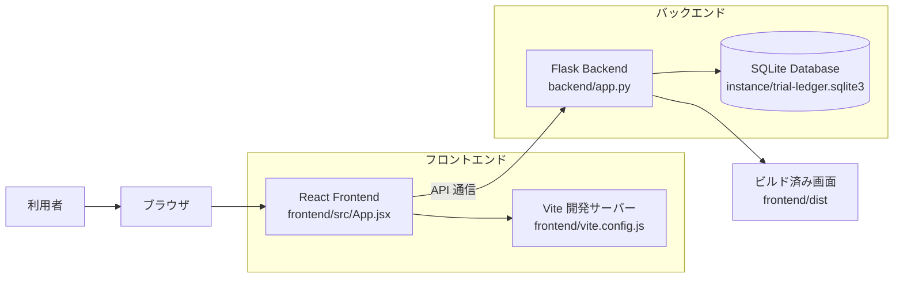
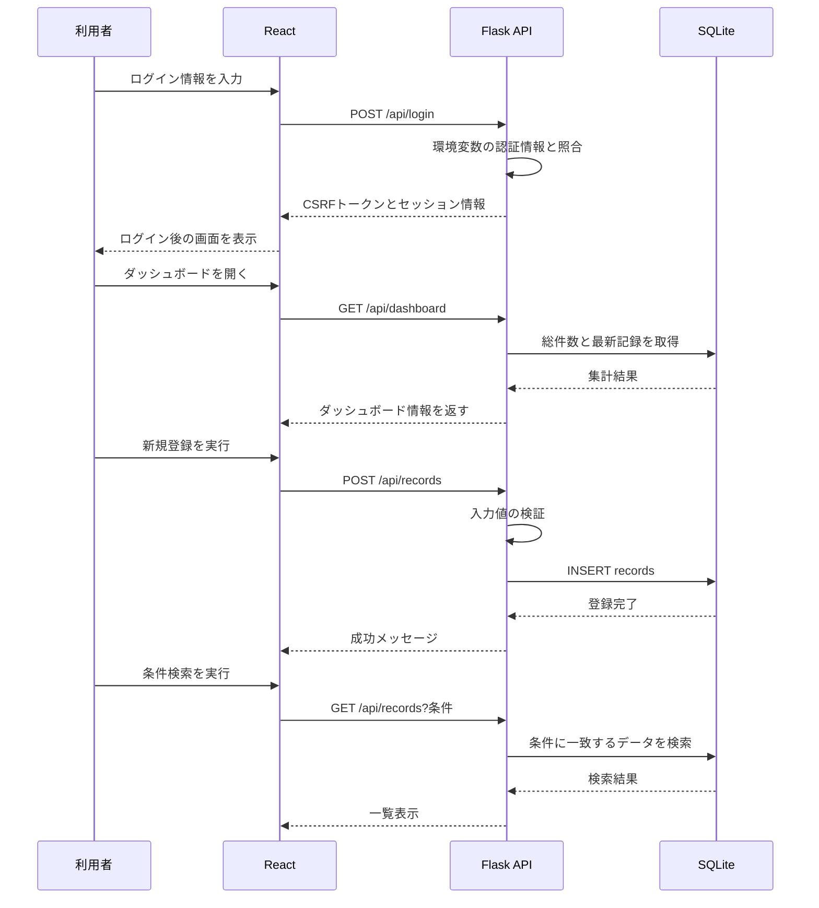
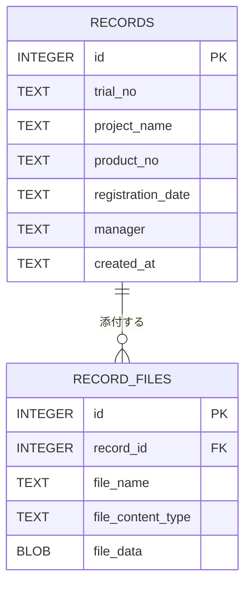

# TestRecordSystem 設計書

## 1. 概要

TestRecordSystem は、試験結果の登録・検索・管理を行う Web アプリケーションです。

- フロントエンド: React
- バックエンド: Flask
- データベース: SQLite
- 目的: 試験記録の一元管理

主な機能は次のとおりです。

- ログイン
- ダッシュボード表示
- 試験記録の新規登録
- 記録の検索
- 記録の変更・削除・コピー
- 添付ファイルの保存とダウンロード
- セッションベースの認証

---

## 2. システム構成

> Mermaid が見えない場合は、次のテキスト図を参照してください。

```text
+-------------------+       API/HTML/JS      +--------------------+
| 利用者            | ----------------------> | ブラウザ           |
|  (ユーザー)       |                         | React画面          |
+-------------------+                         +---------+----------+
                                                           |
                                                           | 1. ログイン
                                                           v
                                             +---------------------------+
                                             | Flask API (backend/app.py)|
                                             | - /api/session            |
                                             | - /api/login              |
                                             | - /api/dashboard          |
                                             | - /api/records            |
                                             +------------+--------------+
                                                          |
                                                          | 2. データ保存/検索
                                                          v
                                             +---------------------------+
                                             | SQLite                    |
                                             | instance/trial-ledger.sqlite3 |
                                             +---------------------------+
                                                          ^
                                                          |
                                                          | 3. 結果返却
                                                           
                                             +---------------------------+
                                             | React 画面               |
                                             | ダッシュボード/検索結果  |
                                             +---------------------------+
```



### 2.1 ファイル構成

```text
TestRecordSystem/
├── backend/
│   └── app.py                     # Flask アプリ、API、SQLite 処理
├── requirements.txt               # Python の依存パッケージ
├── README.md                      # セットアップ・起動・運用方法
├── docs/
│   ├── 設計書.md                  # 本設計書
│   ├── 試験結果台帳要件.md         # 要件資料
│   └── images/
│       └── image*.png             # 画面・仕様関連の画像資料
├── tests/
│   └── test_app.py                # Flask API のテスト
├── frontend/
│   ├── package.json               # React/Vite の依存関係とコマンド
│   ├── package-lock.json          # npm 依存関係の固定情報
│   ├── index.html                 # React を表示する HTML の土台
│   ├── style.css                  # React 画面全体のスタイル
│   ├── vite.config.js             # Vite 開発サーバーとビルド設定
│   ├── src/
│   │   ├── main.jsx               # React の起動、CSS の読み込み
│   │   └── App.jsx                # ログイン・概要・登録・検索画面
│   └── dist/                      # npm run build で生成される配信用ファイル
└── instance/
    └── trial-ledger.sqlite3       # 実行時に作成・使用する SQLite DB
```

`frontend/dist/` と `instance/` は実行・ビルド時に使われるデータです。どちらも Git 管理対象外として設定されています。`.venv/`、`frontend/node_modules/`、`.tools/` も開発環境用で、ソースコードの構成には含めていません。

### 2.2 役割分担

- React Frontend
  - ページの表示を担当
  - ログイン画面、ダッシュボード、新規登録、検索画面を構成
  - API を呼び出してデータを取得・登録する

- Flask Backend
  - API を提供する
  - 認証・セッション管理を行う
  - SQLite へ接続し、データを保存・検索する
  - 添付ファイルを保存し、ダウンロード可能にする

- SQLite
  - 試験記録の永続化先
  - `records` テーブルにデータを保持する

---

## 3. 実行フロー

```text
[利用者]
   |
   | 1. ログイン入力
   v
[React 画面]
   |
   | POST /api/login
   v
[Flask API]
   | - 環境変数の認証情報と照合
   | - セッション開始
   | - CSRFトークン発行
   v
[SQLite]
   | - データ取得/保存
   v
[Flask API]
   | - 結果を JSON で返却
   v
[React 画面]
   | - ダッシュボード更新
   | - 一覧表示
   v
[利用者]
```



---

## 4. データモデル



### 4.1 `records` テーブルの項目

| 項目名 | 型 | 説明 |
|---|---|---|
| id | INTEGER | レコードの一意な識別子 |
| trial_no | TEXT | 試験番号 |
| project_name | TEXT | 案件名 |
| product_no | TEXT | 製番 |
| registration_date | TEXT | 登録日（yyyymmdd） |
| manager | TEXT | 担当者 |
| created_at | TEXT | 登録日時 |

添付ファイルは `record_files` テーブルに保存します。1つの記録に複数のファイルを紐づけます。
旧バージョンのDBにある `records.file_name` / `file_content_type` / `file_data` は、起動時に `record_files` へ移行されます。

| 項目名 | 型 | 説明 |
|---|---|---|
| id | INTEGER | 添付ファイルの一意な識別子 |
| record_id | INTEGER | 親となる `records.id` |
| file_name | TEXT | 添付ファイル名 |
| file_content_type | TEXT | MIME タイプ |
| file_data | BLOB | ファイル本体 |

---

## 5. 画面構成

### 5.1 ログイン画面

- ユーザー ID とパスワードを入力する
- 認証成功時にメイン画面へ遷移する
- 認証失敗時にエラーメッセージを表示する

### 5.2 ダッシュボード画面

- 登録済み件数の表示
- 今月の登録件数の表示
- 直近の記録の表示
- 「新規登録」「記録を検索」への案内

### 5.3 新規登録画面

入力項目:

- 試験番号
- 案件名
- 製番
- 登録日
- 担当者
- 添付ファイル（複数選択可能）

### 5.4 記録変更画面

- 検索結果から選択した記録の項目を編集する
- 既存の添付ファイルは初期状態で維持し、個別に削除を指定できる
- 新しい添付ファイルを追加できる
- 変更をキャンセルすると編集状態を破棄する
- ログアウト時は編集中の内容を破棄する

### 5.5 検索画面

検索条件:

- 試験番号
- 製番
- 登録日
- 担当者

結果は一覧テーブルとして表示され、記録の変更・コピー・削除を実行できる。

---

## 6. API 設計

### 6.1 セッション情報取得

- エンドポイント: `GET /api/session`
- 役割: ログイン状態の確認と CSRF トークンの取得

### 6.2 ログイン

- エンドポイント: `POST /api/login`
- 役割: 認証処理とセッション開始

### 6.3 ログアウト

- エンドポイント: `POST /api/logout`
- 役割: セッションを破棄する

### 6.4 ダッシュボード取得

- エンドポイント: `GET /api/dashboard`
- 役割: 総件数、今月件数、最新レコードを返す

### 6.5 記録一覧・登録・変更

- エンドポイント: `GET /api/records`, `POST /api/records`, `PUT /api/records/<record_id>`, `DELETE /api/records/<record_id>`
- 役割:
  - `GET`: 条件付きの一覧と、それぞれの添付ファイル情報を取得
  - `POST`: 新規レコードと複数添付ファイルを登録
  - `PUT`: 記録項目を変更し、指定した既存添付の削除と新規添付の追加を行う
  - `DELETE`: 記録と紐づく添付ファイルを削除する
  - 更新は一つのSQLiteトランザクションで実行し、入力検証に失敗した場合は既存データを変更しない

### 6.6 添付ファイル取得

- エンドポイント: `GET /api/records/<record_id>/files/<file_id>`
- 役割: 登録済み添付ファイルをダウンロードする

---

## 7. 認証とセキュリティ

- `LEDGER_SECRET_KEY` を Flask の秘密鍵として使う
- ログインは環境変数の設定値と照合する
- パスワードはハッシュ化して保存する
- 更新系 API は `CSRF` トークンで保護する
- 添付ファイルは1件100 MB以下、1回の登録・変更で追加する合計も100 MB以下とする
- セッションを利用してログイン状態を維持する

---

## 8. フロントエンドとバックエンドの責務分担

### フロントエンドの責務

- 画面ドラッグと表示
- 入力値の画面側バリデーション
- API 呼び出し
- エラーメッセージ表示
- 画面遷移と状態管理

### バックエンドの責務

- 外部入力の検証
- 認証
- データ保存
- 添付ファイル保存
- セッション管理
- 例外ハンドリング

---

## 9. 実装上のポイント

- `backend/app.py` では `create_app()` を使って Flask アプリを生成する
- DB 接続と初期化処理を共通化している
- `initialize_database()` が起動時に必要なテーブルを作成する
- `require_login()` と `require_csrf()` により API を保護する
- `frontend/dist` が存在しない場合は、ビルドを促すエラーを返す

---

## 10. まとめ

TestRecordSystem は、以下の構成で設計されています。

- フロントエンド: React
- バックエンド: Flask
- データ保存: SQLite
- 認証: セッション + CSRF
- 主要機能: 登録・検索・ダウンロード・認証

この構成により、画面ロジックと API ロジックが分離されており、保守しやすく拡張しやすい設計になっています。
