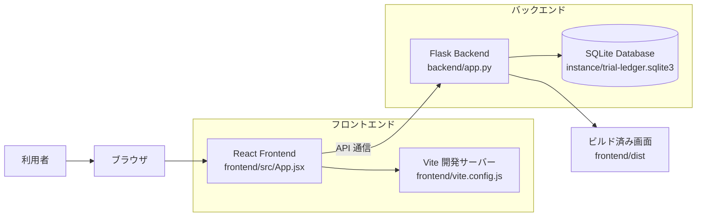
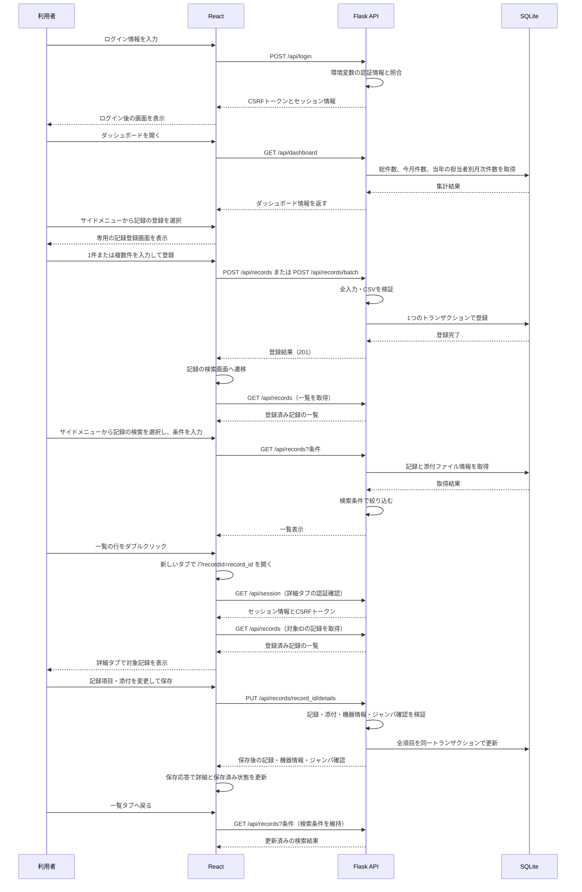
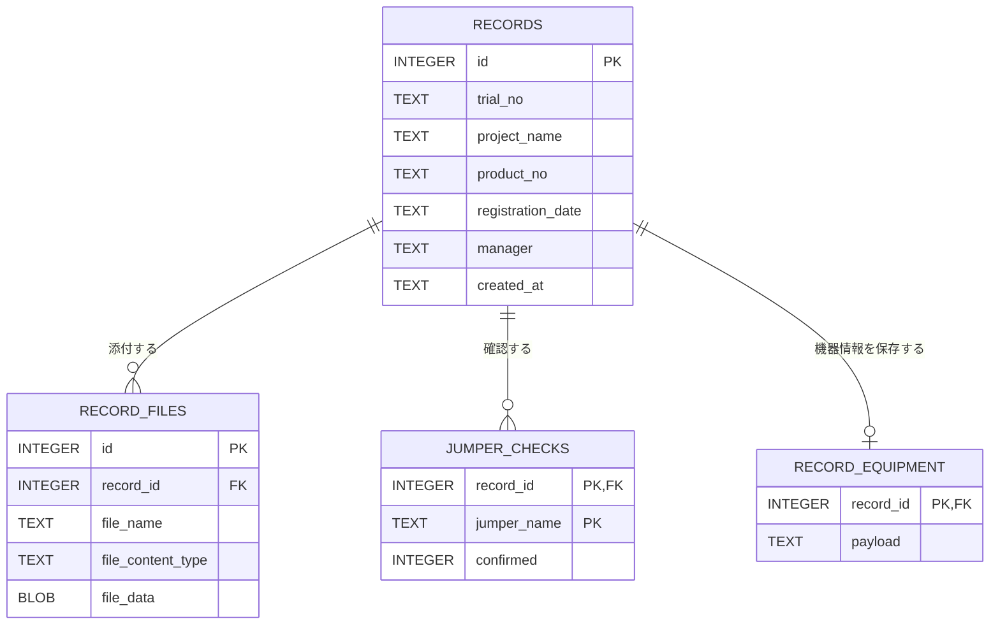

# TestRecordSystem 設計書

## 1. 概要

TestRecordSystem は、試験結果の登録・検索・管理を行う Web アプリケーションです。

- フロントエンド: React
- バックエンド: Flask
- データベース: SQLite
- 目的: 試験記録の一元管理

主な機能は次のとおりです。

- ログイン
- ダッシュボード表示
- 記録の登録画面での新規登録、記録の検索画面での検索
- 詳細画面での記録変更、一覧からの削除・コピー
- 詳細画面での添付ファイルの追加・削除・ダウンロード
- 受入検査タブでの電源基板試験成績票PDFの登録と画面内プレビュー
- 試験結果CSVの温度別表表示と保存前プレビュー
- 記録ごとのジャンパ設定確認と機器情報の保存
- 記録ごとの回覧フローと段階ごとのメール通知
- セッションベースの認証

---

## 2. システム構成

> Mermaid が見えない場合は、次のテキスト図を参照してください。

```text
+-------------------+       API/HTML/JS      +--------------------+
| 利用者            | ----------------------> | ブラウザ           |
|  (ユーザー)       |                         | React画面          |
+-------------------+                         +---------+----------+
                                                           |
                                                           | 1. ログイン
                                                           v
                                             +---------------------------+
                                             | Flask API (backend/app.py)|
                                             | - /api/session            |
                                             | - /api/login              |
                                             | - /api/dashboard          |
                                             | - /api/records            |
                                             +------------+--------------+
                                                          |
                                                          | 2. データ保存/検索
                                                          v
                                             +---------------------------+
                                             | SQLite                    |
                                             | instance/trial-ledger.sqlite3 |
                                             +---------------------------+
                                                          ^
                                                          |
                                                          | 3. 結果返却
                                                           
                                             +---------------------------+
                                             | React 画面               |
                                             | ダッシュボード/検索結果  |
                                             +---------------------------+
```



### 2.1 ファイル構成

```text
TestRecordSystem/
├── backend/
│   ├── app.py                     # Flask アプリ、API、SQLite 処理
│   └── trial_results.py           # 試験結果CSVの解析と形式検証
├── requirements.txt               # Python の依存パッケージ
├── README.md                      # セットアップ・起動・運用方法
├── docs/
│   ├── 設計書.md                  # 本設計書
│   ├── 試験結果台帳要件.md         # 要件資料
│   └── images/
│       └── image*.png             # 画面・仕様関連の画像資料
├── tests/
│   └── test_app.py                # Flask API のテスト
├── frontend/
│   ├── package.json               # React/Vite の依存関係とコマンド
│   ├── package-lock.json          # npm 依存関係の固定情報
│   ├── index.html                 # React を表示する HTML の土台
│   ├── style.css                  # React 画面全体のスタイル
│   ├── vite.config.js             # Vite 開発サーバーとビルド設定
│   ├── src/
│   │   ├── main.jsx               # React の起動、CSS の読み込み
│   │   ├── App.jsx                # ログイン・概要・登録検索・詳細画面
│   │   └── TrialResults.jsx       # CSV基本情報・結果表・検索・ページング
│   └── dist/                      # npm run build で生成される配信用ファイル
└── instance/
    └── trial-ledger.sqlite3       # 実行時に作成・使用する SQLite DB
```

`frontend/dist/` と `instance/` は実行・ビルド時に使われるデータです。どちらも Git 管理対象外として設定されています。`.venv/`、`frontend/node_modules/`、`.tools/` も開発環境用で、ソースコードの構成には含めていません。

### 2.2 役割分担

- React Frontend
  - ページの表示を担当
    - ログイン画面、ダッシュボード、記録の登録画面、記録の検索画面を構成
    - 記録詳細は別ブラウザータブの専用ページで表示する
  - API を呼び出してデータを取得・登録する

- Flask Backend
  - API を提供する
  - 認証・セッション管理を行う
  - SQLite へ接続し、データを保存・検索する
  - 添付ファイルを保存し、ダウンロード可能にする

- SQLite
  - 試験記録の永続化先
    - `records` に記録、`record_files` に試験結果ファイル、`power_board_reports` に電源基板試験成績票PDFを保持する
    - `jumper_checks` にジャンパ確認、`record_equipment` に機器情報を保持する

---

## 3. 実行フロー

```text
[利用者]
   |
   | 1. ログイン入力
   v
[React 画面]
   |
   | POST /api/login
   v
[Flask API]
   | - 環境変数の認証情報と照合
   | - セッション開始
   | - CSRFトークン発行
   v
[SQLite]
   | - データ取得/保存
   v
[Flask API]
   | - 結果を JSON で返却
   v
[React 画面]
   | - ダッシュボード更新
   | - 一覧表示
   v
[利用者]
```



---

## 4. データモデル



### 4.1 `records` テーブルの項目

| 項目名 | 型 | 説明 |
|---|---|---|
| id | INTEGER | レコードの一意な識別子 |
| trial_no | TEXT | 試験番号。必須 |
| project_name | TEXT | 案件名。任意、未入力は空文字で保存 |
| product_no | TEXT | 製番。任意、未入力は空文字で保存 |
| registration_date | TEXT | 登録日（yyyymmdd）。通常の新規登録は当日 |
| manager | TEXT | 担当者。必須 |
| created_at | TEXT | 登録日時 |

試験結果ファイル（CSVおよび旧形式添付）は `record_files` テーブルに1記録あたり1件保存します。電源基板試験成績票PDFは `power_board_reports` テーブルに1記録あたり1件保存します。
CSVも元のファイルをBLOBとして保存し、表示用JSONは取得時に解析して返します。解析結果を保存する新しいテーブルは設けません。
旧バージョンのDBにある `records.file_name` / `file_content_type` / `file_data` は、起動時に `record_files` へ移行されます。

| 項目名 | 型 | 説明 |
|---|---|---|
| id | INTEGER | 添付ファイルの一意な識別子 |
| record_id | INTEGER | 親となる `records.id` |
| file_name | TEXT | 添付ファイル名 |
| file_content_type | TEXT | MIME タイプ |
| file_data | BLOB | ファイル本体 |

`power_board_reports` の `record_id` は一意で、親記録の削除時にPDFも削除します。

| 項目名 | 型 | 説明 |
|---|---|---|
| id | INTEGER | 試験成績票PDFの一意な識別子 |
| record_id | INTEGER | 親となる `records.id`（1記録につき1件） |
| file_name | TEXT | PDFファイル名 |
| file_data | BLOB | PDFファイル本体 |

案件名・製番は `NOT NULL` の既存列に空文字を保存するため、今回の入力項目変更に伴うテーブル再作成は不要です。

### 4.2 `jumper_checks` テーブル

| 項目名 | 型 | 説明 |
|---|---|---|
| record_id | INTEGER | 親となる `records.id`。複合主キーの一部 |
| jumper_name | TEXT | `equipment-config.json` で設定したジャンパ名。複合主キーの一部 |
| setting | TEXT | 確認時の設定値。設定変更後に古い確認状態を引き継がないために保存 |
| confirmed | INTEGER | `0`: 未確認、`1`: 確認済み |

ジャンパ名・設定値は `equipment-config.json` の `jumpers` 配列で定義し、確認結果は記録ごとに保存します。配列未指定時は `W1`・`W2` を既定値として扱い、既存DBの固定名制約は起動時に移行します。未保存または設定値が変更された確認結果は未確認として返します。

### 4.3 `record_equipment` テーブル

| 項目名 | 型 | 説明 |
|---|---|---|
| record_id | INTEGER | 親となる `records.id`。主キー |
| payload | TEXT | 基板情報・使用計測器・ソフト／PLD情報をまとめたJSON |

JSON のキーは `boards`、`instruments`、`software` です。未保存時は固定項目と空欄の入力項目を含む初期値を返します。添付ファイル・ジャンパ確認・機器情報は記録削除時に外部キーの `ON DELETE CASCADE` で削除します。

### 4.4 `appearance_checks` テーブル

| 項目名 | 型 | 説明 |
|---|---|---|
| record_id | INTEGER | 親となる `records.id`。複合主キーの一部。記録削除時にCASCADEで削除 |
| check_key | TEXT | `項目キー:基板名`。複合主キーの一部 |
| setting | TEXT | 確認時の項目名・基準値をJSONで保存。設定変更後に確認状態を引き継がないために使用 |
| confirmed | INTEGER | `0`: 未確認、`1`: 確認済み |

未保存または項目名・基準値が変わった確認結果は未確認として返します。基板グループ・確認項目・表示行数・基準値・対象セルは `equipment-config.json` の `appearanceInspection` から取得します。未指定時は従来の6項目を使用します。旧テーブルには起動時に `setting` 列を追加し、旧固定表の設定値を補うため、設定が同じ確認結果は維持されます。

### 誤挿入キー確認の保存

`insertion_key_checks` は記録IDとコネクタ名を複合主キーとし、確認時のキー位置と確認結果を記録します。未保存時は未確認とし、固定されたキー位置が変更された場合は確認済みを引き継ぎません。記録削除時にCASCADEで削除します。

---

## 5. 画面構成

### 5.1 ログイン画面

- ユーザー ID とパスワードを入力する
- 認証成功時にメイン画面へ遷移する
- 認証失敗時にエラーメッセージを表示する

### 5.2 ダッシュボード画面

- 登録済み件数の表示
- 今月の登録件数の表示
- 当年1月から12月までの担当者別対応件数を折れ線グラフで表示する
- 月ごとの全対応件数に対する担当者別比率を100%積み上げ棒グラフで表示する
- 集計には記録の登録日と担当者を使用し、当年以外の記録は含めない
- グラフに年・月・担当者名・凡例を表示する。月に記録がない場合は0件・棒なしとする
- 「記録の登録」と「記録の検索」へのボタンを横並びで配置する
- 「直近の記録」および「操作メニュー」カードは配置しない
- 画面幅が狭い場合はグラフを縦に並べ、グラフ内を横スクロール可能にする

### 5.3 記録の登録画面

- サイドメニューの「記録の登録」から専用画面へ遷移する
- 試験番号・案件名・製番・登録日・担当者を入力し、試験結果CSVを任意で添付できる
- 記録行を追加・削除し、複数件を一括登録できる。追加行には案件名・製番・登録日・担当者を引き継ぐ
- 新規登録の各行に採番ボタンを設け、サーバー日付の `YYMMNNNN` 形式で試験番号を月次採番する。SQLiteトランザクションで予約し、既存記録と予約済み番号を飛ばす。登録しなかった予約番号も再利用しない
- 既存記録と重複する試験番号は登録・変更しない。一括登録内での重複も検証し、重複があれば一件も保存せずエラーを返す
- 複数件登録は全行とファイルを検証後に一括保存し、1件でも不正なら一部保存しない
- 登録成功後は記録の検索画面へ遷移して一覧を更新する
- 保存失敗時は入力内容を維持してエラーを表示する。送信中は二重送信を防ぐ

入力条件は次のとおりです。画面側とAPI側の双方で検証します。

| 項目 | 条件 | 入力箇所 |
|---|---|---|
| 試験番号 | 必須、半角英数字・ハイフン、20文字以内 | 新規登録・詳細 |
| 担当者 | 必須、日本語、30文字以内 | 新規登録・詳細 |
| 案件名 | 任意、日本語または英数字・空白・ハイフン、30文字以内 | 新規登録・詳細 |
| 製番 | 任意、半角英数字・空白・ハイフン、30文字以内 | 新規登録・詳細 |
| 登録日 | 実在する日付、yyyymmdd形式。新規登録では当日を初期値にする | 新規登録・詳細 |

### 5.4 記録の詳細ページ（別タブ）

- 検索一覧の行をクリックすると選択状態になる。ダブルクリックまたは「詳細」で別ブラウザータブに開く
- キーボードでは行へのフォーカス後、スペースで選択、Enterで別タブに詳細を開く
- URLは `/?recordId=<record_id>` とし、検索一覧を元のタブに残したまま複数件の詳細を同時に開ける
- 各タブでセッション・CSRFトークンを取得し、`GET /api/records` の結果から対象IDを選んで表示する。機器情報とジャンパ確認も取得し、すべての取得が完了してから編集画面を表示する。バックエンドの画面ルートは追加しない
- URLからの直接表示と再読み込みに対応する。未認証の場合はログイン画面を表示し、ログイン後に対象記録を取得する
- タブ名は「試験番号 - 記録の詳細」とする。画面見出しにも試験番号を表示する
- 不正なID、存在しない記録、取得失敗の場合はエラーを表示する
- 一覧の「変更」ボタンと独立した記録変更画面は廃止する
- 詳細画面で試験番号・案件名・製番・登録日・担当者を編集する。案件名・製番は空欄でも保存できる
- 新規登録時にCSVを添付できる。詳細画面からも追加・削除・ダウンロードできる
- CSVが登録済みの記録は、詳細画面を開いたときに試験結果タブを初期表示する
- 既存添付は初期状態で維持し、「削除する」で個別指定する。削除は「変更を保存」時に確認して実行する
- 各詳細タブの入力・添付選択・保存状態は独立させる
- 最下部の共通の「変更を保存」で記録項目・添付変更・機器情報・ジャンパ確認を一括保存する。入力検証またはDB更新が失敗した場合は全変更を保存しない
- 保存成功時はAPI応答の保存後データで詳細タブと保存済み状態を更新する。保存後の再取得は不要とする。一覧タブは戻った時点で検索結果を再取得する
- 「変更をキャンセル」で記録項目・添付選択・機器情報・ジャンパ確認の編集状態を破棄して保存済みの内容に戻す。未保存の変更があれば確認する
- 閉じるボタン・Escで詳細タブを閉じる。いずれかの項目に未保存の変更がある場合、タブを閉じる・再読み込み・画面離脱時に `beforeunload` でブラウザー標準の警告を出す
- ブラウザーがスクリプトによるタブの終了を制限する場合は、ブラウザーのタブ操作で閉じる
- 共通保存中は記録項目・添付・機器情報・ジャンパ確認の入力、保存・キャンセル・閉じる操作を無効にする
- ログアウト時は編集中の内容を破棄する
- 同じ記録を複数タブで編集した場合の競合検出は行わず、最後に保存した値を採用する。別タブの未保存入力は自動更新しない

#### 試験結果CSV

- 新しく追加する試験結果ファイルは `.csv` とし、UTF-8（BOMあり・なし）とShift_JIS（CP932）に対応する
- 登録項目・添付の下、機器情報の前に、基本情報と試験結果表を表示する
- 品名・仕様書番号・試験番号の順に表示し、CSVの情報で台帳項目を自動変更しない
- 「試験結果 1」は下限値・上限値・単位と3温度のMIN／判定／MAX／判定、「試験結果 2」は規定値・単位と3温度の測定値／判定を表示する
- 2種類の結果表はタブで切り替え、各温度をまとめた列見出しを使用する
- 数値変換を行わず、HEX値の先頭ゼロ、測定値の桁、空欄と「-」を保持する
- PASSは緑、FAIL・NGは赤、その他・空欄の判定は中立色で表示する。空欄の表示は「-」とする
- 各試験項目は、1件でもFAILまたはNGがあればFAIL、すべてPASSならPASS、それ以外は未判定として集計する
- 画面上は「アナログ系」「デジタル系」タブで切り替える。No.・試験名称の検索、NG・未判定・PASSによる絞り込み、50件ずつのページングに対応する。大きな表は表内で縦横スクロールし、No.列と見出しを固定する。列境界のドラッグで列幅を変更でき、各タブの幅を詳細画面内で保持する
- 保存済みCSVと新しく選択したCSVを切り替えられる。選択時のプレビューではDBを更新しない
- 不正なCSV・通信エラーはメッセージ表示とし、別ファイルの古い表を表示しない
- CSV以外の既存添付はダウンロードのみ維持し、結果表としては表示しない

#### ジャンパ設定の確認

- 受入検査タブの誤挿入キー確認の下、インストールソフトの上に `equipment-config.json` で定義したジャンパ設定と確認結果を表示する
- チェック切り替え時は画面の編集状態だけを変更し、APIへ送信しない
- 共通の「変更を保存」で確認結果を保存する。保存失敗時は未保存の入力を維持し、エラーを表示する
- 詳細画面の共通情報欄に保存・キャンセルボタンと結果メッセージを配置する

#### 機器情報

- 詳細タブは「試験情報」「受入検査」「試験結果」「出荷検査」「回覧」とする
- 受入検査タブの先頭に「外観確認」を配置する。見出し・項目・順序は `appearanceInspection` の `boardGroups`・`items` で指定する（最大50項目・基板列は合計50件）。項目の `rows: 1` は基準値とチェックを1行に、`rows: 2` は番号・項目名を縦結合して基準値とチェックを上下2行に表示する。`values` にない基板は「-」とする。ジャンパ確認と共通のチェック表示を使い、共通保存・キャンセル・未保存警告の対象とする
- 試験情報タブに基板情報と使用計測器を表示する。受入検査タブには外観確認、誤挿入キー確認、ジャンパ設定、インストールソフト、PLDバージョン、電源基板試験成績票の順に表示する
- 誤挿入キー確認はバックボード側のP31・P32・P34・PS3を列、A〜Mの位置（Jを除く）を行とする表を表示する。右隣に基板側のINF265・PWM85・INF267・PWS132を対応する列に同じ位置の行で表示し、A〜Dはキーなし、E〜M（Jを除く）はバックボード側にキーがない位置を基板側のキー位置とする。画面幅が足りない場合は両表を横スクロールできる。固定されたキー位置は四角を塗りつぶして表示し、各側の最下段に１つずつ独立した確認チェックを置く。全コネクタが確認済みの場合のみチェック済みと表示し、チェック操作でその側の全コネクタの状態を変更する。一部だけ確認済みの旧記録は未確認と表示するが、操作しなければ保存済みの個別状態を維持する。チェックはジャンパ設定と同じ共通保存・キャンセル・未保存警告の対象とする
- `boards`: 表示行数と既定値は `equipment-config.json` の `boards` 配列（最大50件）で設定する。各行は `name`・`serialNumber` のみを持ち、各100文字以内。設定値 `""` は空欄で表示する。旧データのレビジョン・ネガは読み込み時に除外し、シリアル番号は維持する。シリアル番号がない場合はJSONの既定値を補う
- `instruments`: 5行の `name`・`managementNo`・`testItems` は100文字以内の任意文字列を入力できる。計測器候補と自動入力する管理番号は `equipment-config.json` の `instrumentChoices` で指定し、変更後はサーバーを再起動する
- `software`: 1行目をインストールソフト、2・3行目をPLDバージョンとして分けて表示する。ソフト名・SD形式は固定、`version`・`checksum` を入力する
- `jumpers`: 表示する行数、ジャンパ名、設定値を `equipment-config.json` で指定する（最大50件、配列未指定時はW1・W2）。設定値が変更された場合、そのジャンパの保存済み確認状態は未確認として扱う
- 受入検査タブの末尾に「電源基板試験成績票」を配置する。PDFを1記録につき1件登録し、登録後は画面内でプレビューできる。追加・削除は即時保存する
- 各入力は100文字以内とし、共通の「変更を保存」で他の項目とまとめて保存する
- 「機器情報を保存」ボタンは廃止し、「変更をキャンセル」は機器情報にも適用する

#### 回覧フロー

- 記録詳細に「回覧」タブを設け、初期2段階（担当・調査）から記録ごとに1～20段階の段階名・担当者名・メールアドレスを保存できる。段階名は「担当」「調査」「承認」から選び、担当者は `managerChoices` の候補から選択して設定済みメールアドレスを自動入力する。段階の追加・削除・並べ替えに対応する
- フロー開始時に最初の担当者へメール通知し、現在段階の完了操作時に次の担当者へ通知する。最終段階の完了でフローを完了にする
- 回覧状態・各段階の通知／完了時刻・操作履歴をSQLiteへ保存し、記録削除時に関連データも削除する。回覧中のフローは編集不可、完了後は新規フローを作成可能とする
- SMTP送信失敗時は段階状態を変更せず、エラーを応答する。SMTP設定は `LEDGER_SMTP_HOST`、`LEDGER_SMTP_SENDER`、任意の認証情報・ポート・STARTTLS設定を環境変数で受け取る
- 通知メールのリンク先は `LEDGER_PUBLIC_URL` で指定できる。省略時はリクエストURLを使用する
- 現行の共通ログインでは個人別の操作制限を行わず、担当者名・メールアドレスは通知先として扱う

### 5.5 記録の検索画面

- サイドメニューと画面見出しは「記録の登録」「記録の検索」とし、別画面にする
- 記録の検索画面には検索条件と検索結果を配置する。登録画面に検索一覧を置かない
- 一覧タブのフォーカス復帰・表示復帰時に、検索条件を維持して結果を再取得する
- 「詳細」リンクは `target="_blank"` と `rel="noopener noreferrer"` を使用する。ダブルクリック・Enterも同様に新しいタブを要求する

検索条件:

- 試験番号
- 案件名
- 製番
- 登録日
- 担当者

検索条件は上記の順で配置し、条件変更後に自動検索する。空欄は絞り込みに使わない。通常文字は先頭一致、`*`は任意の文字列として扱い、複数条件を指定した場合はすべてに一致する記録を返す。検索文字列を正規表現として実行しない。

結果は試験番号・案件名・製番・登録日・担当者・操作の6列で表示する。添付ファイル列・ダウンロードリンクは表示しない。

操作列には「詳細」「コピー」「削除」を配置する。「コピー」は記録の登録画面へ遷移し、試験番号・案件名・製番・登録日・担当者を登録用の値として引き継ぐ。添付ファイル・ジャンパ確認・機器情報はコピーしない。

「削除」は確認後に記録と関連データを削除し、一覧から除く。削除した記録は復元できない。

---

## 6. API 設計

### 6.1 セッション情報取得

- エンドポイント: `GET /api/session`
- 役割: ログイン状態の確認と CSRF トークンの取得

### 6.2 ログイン

- エンドポイント: `POST /api/login`
- 役割: 認証処理とセッション開始

### 6.3 ログアウト

- エンドポイント: `POST /api/logout`
- 役割: セッションを破棄する

### 6.4 ダッシュボード取得

- エンドポイント: `GET /api/dashboard`
- 役割: 総件数、今月件数、当年の担当者別月次件数を返す
- 担当者別集計は12か月分の件数を返し、記録の登録日と担当者を基準にする
- 対応比率は画面側で月ごとの全件数を分母にして算出する

### 6.5 記録一覧・登録・変更

- エンドポイント: `GET /api/records`, `POST /api/records`, `PUT /api/records/<record_id>`, `DELETE /api/records/<record_id>`
- 役割:
  - `GET`: 条件付きの一覧と、添付ファイル・電源基板試験成績票のメタデータを取得
    - `POST`: 新規レコードを登録し、`201` と `id`、`files` を返す。CSV添付時は解析して形式を検証する
  - `PUT`: 記録項目を変更し、指定した既存添付の削除と新規添付の追加を行う
  - `DELETE`: 記録と紐づく添付ファイルを削除する
    - `POST /api/records/batch`: JSONの記録配列、または `multipart/form-data` の `submissions` と行番号付き `resultFiles-<index>` を受け取り、各行に任意のCSVを1件添付して一括登録する。全記録・CSVを検証後、1つのSQLiteトランザクションで保存する
  - 更新は一つのSQLiteトランザクションで実行し、入力検証に失敗した場合は既存データを変更しない

`GET` の検索パラメーターは `trialNo`（試験番号）、`projectName`（案件名）、`productNo`（製番）、`date`（登録日）、`manager`（担当者）とする。案件名の検索条件は30文字以内とし、空欄なら絞り込みに使用しない。

`POST`・`PUT` は `multipart/form-data` を使用する。試験番号・担当者は必須、案件名・製番は任意で、省略または空欄の場合は空文字を保存する。`POST` で登録日を省略した場合はサーバーの当日を設定し、指定した場合は実在する日付を検証する。`PUT` では登録日を含む記録項目を送信する。

試験番号は登録時に既存記録との重複を大文字・小文字を区別せず検査する。一括登録は要求全体を検査し、重複がある場合は `409` とエラーメッセージを返して一件も登録しない。変更時も、対象記録以外に同じ試験番号がある場合は拒否する。

`POST /api/trial-numbers/next` はログインとCSRF検証後、サーバー日付の `YYMM` と4桁連番を組み合わせた試験番号を予約して返す。既存記録および予約済み番号の最大連番の次を採番し、月あたり9999件を超える場合は `409` を返す。予約は登録・取消にかかわらず再利用しない。

添付追加は `resultFiles`、削除対象は繰り返し指定する `removeFileIds` で送信する。指定していない既存添付は維持する。`.csv` ファイルは形式を検証して保存し、複数件登録時の添付合計は100 MB以下とする。記録項目・添付の更新APIはジャンパ確認と機器情報を変更しない。

### 6.6 添付ファイル取得

- エンドポイント: `GET /api/records/<record_id>/files/<file_id>`
- 役割: 登録済み添付ファイルをダウンロードする

#### 電源基板試験成績票PDF

- `POST /api/records/<record_id>/power-board-report`: PDFを登録する。1記録につき1件、100 MB以下とし、拡張子とPDFシグネチャを検証する
- `GET /api/records/<record_id>/power-board-report`: 認証済み利用者に`application/pdf`としてインラインで返し、画面内プレビューに使用する
- `DELETE /api/records/<record_id>/power-board-report`: 登録済みPDFを削除する
- 登録・削除にはCSRFトークンを必須とする

### 6.7 ジャンパ確認の取得・更新

- エンドポイント: `GET /api/records/<record_id>/jumpers`, `PUT /api/records/<record_id>/jumpers/<jumper_name>`
- `GET`: 設定された各ジャンパの `name`・`setting`・`confirmed` を返す
- `PUT`: JSON の `{"confirmed": true}` または `{"confirmed": false}` で1件の確認結果を保存し、保存後のジャンパ情報を返す
- 設定済みのジャンパ名のみ更新可能。確認結果はJSONの真偽値のみを許可する

### 6.8 機器情報の取得・更新

- エンドポイント: `GET /api/records/<record_id>/equipment`, `PUT /api/records/<record_id>/equipment`
- `GET`: 保存済みの機器情報JSON、または固定項目と空欄を含む初期値を返す
- `PUT`: `boards`・`instruments`・`software` を含むJSONを一括保存し、保存したJSONを返す
- 行数・キー・文字数を検証し、固定の基板名・ソフト名・SD形式の変更を拒否する

添付取得・ジャンパ確認・機器情報を含む記録関連APIはログイン必須とし、更新系APIにはCSRFトークンが必要です。存在しない記録は `404` を返します。

### 6.9 詳細の共通保存

- エンドポイント: `PUT /api/records/<record_id>/details`
- ログインとCSRFトークンを必須とし、`multipart/form-data` で送信する
- 記録項目・`resultFiles`・`removeFileIds` に加えて、JSON文字列の `equipment` と `jumperChecks` を必須とする
- `equipment` は6.8と同じ固定項目・行数・キー・100文字制限で検証する
- `jumperChecks` は設定済みのジャンパ名をキーにしたJSON真偽値をすべて指定する
- 画面は外観確認の `appearanceChecks` もJSON文字列で送信する。現在の設定で確認対象となる `項目キー:基板名` をすべて指定し、値は真偽値のみ許可する。従来クライアントとの互換性のため、省略時は保存済み結果を維持する
- 画面は誤挿入キー確認の `insertionKeyChecks` もJSON文字列で送信する。バックボード側と基板側の8つの識別子すべてをキーに真偽値を指定する。従来クライアントが省略した場合は保存済み結果を維持し、バックボード側の4つだけを送信した場合も基板側の結果を維持する
- 新規添付はすべてCSVの拡張子・文字コード・基本情報・見出し・明細列数を検証する。不正なCSVの場合は全変更を保存しない
- 記録項目・添付の追加／削除・機器情報・ジャンパ確認・外観確認・誤挿入キー確認を1つのSQLiteトランザクションで更新する。DB例外時はすべて巻き戻す
- 成功時は `success`、保存後の `record`、`equipment`、`jumperChecks`、`appearanceChecks`、`insertionKeys` を返す。画面はこの応答を保存済み状態として採用する
- 従来の個別更新APIは互換性のため残すが、詳細画面の保存操作からは使用しない

#### 外観確認の取得

- エンドポイント: `GET /api/records/<record_id>/appearance-checks`
- ログイン必須。存在しない記録は `404` を返す
- `equipment-config.json` の `appearanceInspection` にある `boardGroups` と `items` を返し、`checks` に記録ごとの確認結果を含める。項目は `key`・`name`・`rows`（1または2）・`values` を持つ
- `values` は設定済み基板名をキーとした基準値文字列。空文字は基準値なし、未定義の基板は対象外。項目の `key` は英字で始まる半角英数字・`_`・`-` の50文字以内で一意、名前・基準値は各100文字以内。設定不正は起動時に明示的なエラーとする
- 配列順・表示行数の変更では確認結果を維持し、項目名や基準値が変わったセルは未確認として返す
- 保存は6.9の共通保存APIのみで行う

#### 誤挿入キー確認の取得

- エンドポイント: `GET /api/records/<record_id>/insertion-keys`
- ログイン必須。存在しない記録は `404` を返す
- 保存用の識別子 `name`、画面表示名 `displayName`、固定されたキー位置と、記録ごとの確認結果を返す。バックボード側のP34・PS3の保存用識別子はそれぞれP34・P33とし、基板側は `side: board` と `board:` 付きの識別子で区別する。保存は6.9の共通保存APIで行う

### 6.10 試験結果CSVの取得・プレビュー

- `GET /api/records/<record_id>/files/<file_id>/results`: 保存済みCSVを解析して返す。ログイン必須とし、対象記録に所属する添付だけを取得する
- `POST /api/records/<record_id>/results-preview`: `multipart/form-data` の `resultFile` で1件のCSVを受け取り、保存せずに解析結果を返す。ログインとCSRFトークンを必須とする
- 応答は `metadata` と `sections` を含むJSONとし、各結果表には `number`・`title`・`temperatures`・`rows`・`summary` を含める
- 結果1の測定値は `min`・`minJudgement`・`max`・`maxJudgement`、結果2は `value`・`judgement` とし、元の文字列を保持する
- Python標準の `csv.reader` で引用符・カンマ・改行を処理し、3つの基本情報、各表の3温度と指定の項目見出し・列数を検証する
- CSV以外・解析失敗は `400`、存在しない記録または添付は `404`、プレビューの100 MB超過は `413` とする
- CSVの保存制限と形式検証は新規登録・一括登録・共通保存APIに適用する。既存添付のダウンロードは維持する

---

## 7. 認証とセキュリティ

- `LEDGER_SECRET_KEY` を Flask の秘密鍵として使う
- ログインは環境変数の設定値と照合する
- パスワードはハッシュ化して保存する
- 更新系 API は `CSRF` トークンで保護する
- 添付ファイルは1件100 MB以下、1回の登録・変更で追加する合計も100 MB以下とする
- セッションを利用してログイン状態を維持する
- 回覧通知のSMTP認証情報はサービス環境変数から取得し、ソース管理しない

---

## 8. フロントエンドとバックエンドの責務分担

### フロントエンドの責務

- 画面ドラッグと表示
- 入力値の画面側バリデーション
- API 呼び出し
- エラーメッセージ表示
- 画面遷移と状態管理

### バックエンドの責務

- 外部入力の検証
- 認証
- データ保存
- 添付ファイル保存
- セッション管理
- 例外ハンドリング

---

## 9. 実装上のポイント

- `backend/app.py` では `create_app()` を使って Flask アプリを生成する
- DB 接続と初期化処理を共通化している
- `initialize_database()` が起動時に必要なテーブルを作成する
- `require_login()` と `require_csrf()` により API を保護する
- `frontend/dist` が存在しない場合は、ビルドを促すエラーを返す
- APIコードを更新した場合はPythonサーバーを再起動する。起動済みプロセスには変更が自動反映されない
- 再起動前のAPIでは案件名・製番が必須として扱われる場合があるため、2項目登録への更新時は特に再起動を確認する
- Flaskから画面を配信する場合は `npm run build` でフロントエンドも更新し、ブラウザーを再読み込みする
- 登録APIのテストには、試験番号・担当者のみの登録、任意項目が空欄のままの添付追加、詳細の後追い入力、不正入力の拒否を含める

---

## 10. まとめ

TestRecordSystem は、以下の構成で設計されています。

- フロントエンド: React
- バックエンド: Flask
- データ保存: SQLite
- 認証: セッション + CSRF
- 主要機能: 登録・検索、詳細編集・添付管理、ジャンパ確認・機器情報保存、認証

この構成により、画面ロジックと API ロジックが分離されており、保守しやすく拡張しやすい設計になっています。
